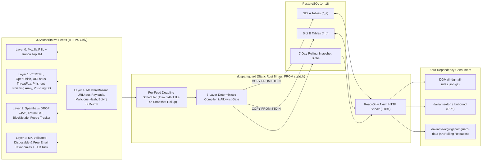

# `dgspamguard` Architecture

`dgspamguard` is a single-binary pure-Rust threat intelligence compiler and read-only query engine backed by PostgreSQL. It is engineered for predictable memory usage (`~3–8 MB` idle RSS during normal read traffic), zero external runtime query dependencies, and zero-downtime dataset updates.

---

## 1. End-to-End Topology

---

## 2. Five-Layer Compilation Pipeline

Every `dgspamguard sync` cycle executes under an in-process mutex and PostgreSQL transaction-level advisory lock (`pg_advisory_xact_lock(0x44475350414d0001)`):

1. **Layer 0 — Canonical Domain Boundaries & Allowlist Gates (`src/normalize.rs`)**:
   - All domain names and URL hostnames are converted to lowercase ASCII via strict **IDNA 2008 / Punycode** (`idna` crate), rejecting malformed labels, IP literals in domain-only feeds, ports, and `RFC 2606` test names.
   - **Mozilla Public Suffix List (PSL)** splits ICANN registry suffixes (`co.uk`, `com.au`) from **Private multi-tenant suffixes** (`pages.dev`, `github.io`, `vercel.app`, `netlify.app`, `web.app`, `duckdns.org`, `blogspot.com`).
   - **Tranco Top 1M** attaches global domain popularity ranks and acts as a hard false-positive shield (Top-100K exact domain shield + Top-10K enterprise root shield).
2. **Layer 1 — Multi-Tenant Subtraction & Corroborated Domain/URL Scoring (`src/compiler.rs`)**:
   - **Trusted Apex Gate**: Built-in and operator-configured `trusted` domains (and all subdomains) are excluded from domain threat verdicts.
   - **Subdomain-Isolated Shared Hosting**: Bare roots (`pages.dev`, `github.io`) are never blocked, while tenant subdomains (`verify-wallet.pages.dev`) remain eligible for domain and RPZ blocking.
   - **Path-Isolated Shared Hosting (`PATH_ONLY_SHARED_HOSTS`)**: Shared content hosts (`docs.google.com`, `drive.google.com`, `forms.gle`, `dropbox.com`, `onedrive.live.com`, `raw.githubusercontent.com`, `discord.com`, `t.me`) and URLhaus `abused_legit_*` / offline URLs are never domain-blocked or emitted into DNS RPZ, while exact malicious paths are hashed (`SHA-256`) and blocked in `dgspamguard_urls`.
   - **Corroboration Scoring**: Single-feed hits preserve the feed's base weight; independent corroboration across multiple CSIRTs/feeds boosts confidence (`+8` for 2 sources, `+14` for 3, `+18` for 4+, capped at `100`).
3. **Layer 2 — SMTP Sending IP, Botnet C2 & Hijacked CIDR Intelligence**:
   - Normalizes IPv4/IPv6 addresses and CIDRs (`Spamhaus DROP v4/v6`, `IPsum L3+`, `Blocklist.de mail & bots`, `Feodo Tracker`, `Phishing.Database Active IPs`, `ThreatFox`, `URLhaus`), rejecting RFC 1918/loopback/CGNAT/documentation bogons, overly broad prefixes, and public DNS resolvers (`1.1.1.1`, `8.8.8.8`, `9.9.9.9`, `208.67.222.222`).
4. **Layer 3 — Email Taxonomy & TLD Risk**:
   - Compiles deduplicated MX-validated **disposable/burner** email domains (`verdict = suspicious`) and **free mailbox** providers (`is_free_email = true`, `verdict = clean`), plus TLD risk multipliers (`dgspamguard_tld_risk`).
5. **Layer 4 — Cryptographic File Hash Intelligence & Artifact Packaging**:
   - Normalizes 64-hex `SHA-256` malware attachment indicators (`MalwareBazaar`, `URLhaus Payloads`, `malicious-hash`, `Botvrij`).
   - Emits all **9 `.gz` artifacts**, `manifest.json`, `SHA256SUMS.txt`, and deterministic PAX `bundle.tar.gz`.
   - **DGMail Size Guarantee**: `dgmail-rules.json.gz` is adaptively packed to stay strictly `<= 440 KiB` compressed (`450,560` bytes), safely below DGMail's `500 KiB` (`512,000`-byte) `spam_rules_url` download cap.

---

## 3. Blue/Green (`A`/`B`) Zero-Downtime Cutover & 4h Snapshot Rollup

Query tables exist in two identical physical slots (`_a` and `_b`):
- `dgspamguard_domains_a` / `dgspamguard_domains_b`
- `dgspamguard_urls_a` / `dgspamguard_urls_b`
- `dgspamguard_ips_a` / `dgspamguard_ips_b` (PostgreSQL `CIDR` + GiST `inet_ops` index for longest-prefix matching)
- `dgspamguard_hashes_a` / `dgspamguard_hashes_b`

During sync:
1. `dgspamguard` reads `dgspamguard_state.active_slot` (for example `"a"`) and targets the inactive slot (`"b"`).
2. Within a single transaction, `TRUNCATE` clears `*_b`, `COPY ... FROM STDIN` streams compiled rows, and `dgspamguard_state.active_slot` flips atomically to `"b"`.
3. **Decoupled Fast Swaps vs. Fixed 4-Hour UTC Snapshots**: High-frequency `15m`/`30m`/`1h` feed updates swap live lookup slots immediately (`activate_live_compiled_slot`) with zero tarball overhead, while full `bundle.tar.gz` snapshot archives (`activate_packaged_snapshot`) are packaged on fixed **4-hour UTC boundaries** (`00:00`, `04:00`, `08:00`, `12:00`, `16:00`, `20:00` UTC; `DGSPAMGUARD_SNAPSHOT_INTERVAL_SECONDS=14400`) and pruned automatically after `DGSPAMGUARD_RETENTION_DAYS` (default `7` days).

Domain suffix walks (`a.b.evil.example.com` -> `["a.b.evil.example.com", "b.evil.example.com", "evil.example.com", "example.com"]`) execute as a single `WHERE domain = ANY($1)` B-tree lookup against the active slot.
